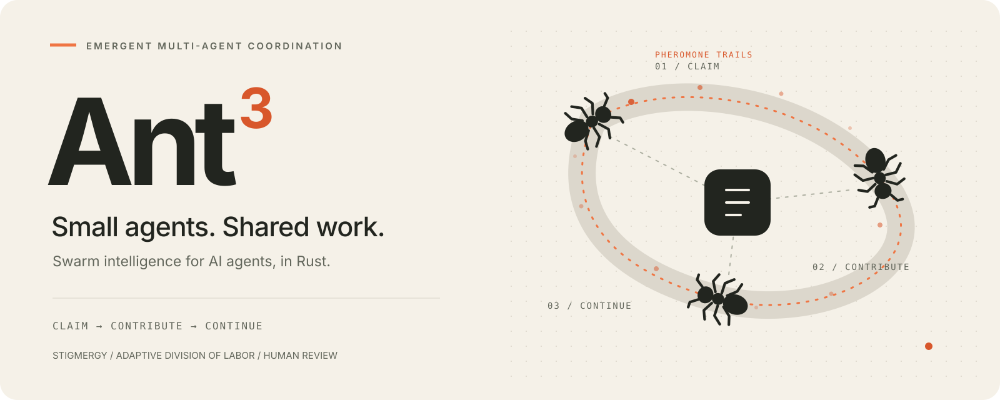
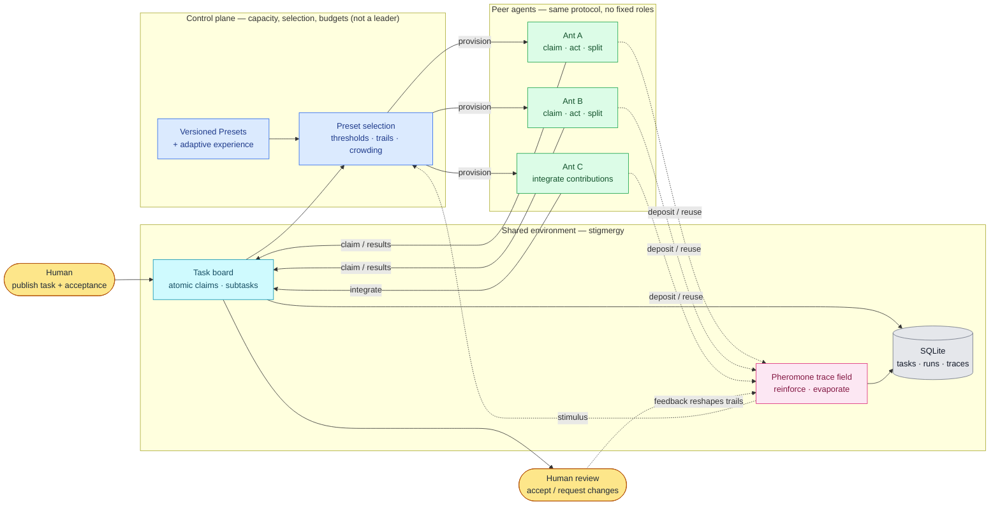

<p align="center">
  
</p>

<h1 align="center">Ant³</h1>

<p align="center"><strong>Swarm intelligence for AI agents, built in Rust.</strong><br>
Small agents. Shared work. Emergent outcomes.</p>

<p align="center">
  <a href="https://github.com/NeoPanic/Ant3/actions/workflows/check.yml"></a>
  <a href="LICENSE"></a>
  
  
  <a href="README.zh-CN.md"></a>
</p>

**Ant³ is a multi-agent platform where peer AI agents self-organize like an ant colony.** Publish a task with acceptance criteria; agents claim work from a shared board, split it, reuse each other's results, and integrate — coordinating through **stigmergy** (a pheromone-style trace field) rather than a fixed planner. No hardcoded role pipelines: division of labor and collective progress *emerge* from local rules.

[简体中文](README.zh-CN.md) · [Documentation](docs/README.md) · [Architecture](docs/managed-agents.zh-CN.md) · [Current status](docs/status.zh-CN.md) · [Contributing](CONTRIBUTING.md)

## Contents

- [Why Ant³](#why-ant)
- [Swarm mechanisms](#swarm-mechanisms)
- [Quick start](#quick-start)
- [How the colony works](#how-the-colony-works)
- [What you can use](#what-you-can-use)
- [Architecture](#architecture)
- [Use the runtime independently](#use-the-runtime-independently)
- [Status \& boundaries](#status--boundaries)
- [Contribute](#contribute)

## Why Ant³

Most multi-agent frameworks hand you a fixed workflow — a planner, a researcher, a summarizer, wired in a script. That is orchestration, not intelligence.

Ant³ takes the opposite bet, inspired by how ants solve hard problems with no central command:

- **No fixed roles.** Planning and integration are *tasks* any peer can claim, not identities baked into the kernel.
- **Coordination through the environment.** Agents leave durable traces; later agents follow what worked. This is [stigmergy](https://en.wikipedia.org/wiki/Stigmergy), the mechanism behind ant trails.
- **Emergence, measured.** A built-in evaluation harness compares one agent against a swarm on the same task and budget, so "the swarm is better" is a claim you can test, not assume.

The result is a local-first, single-binary Rust platform you can run, inspect, and extend — with the model/tool loop usable as a standalone crate.

## Swarm mechanisms

These are implemented today, not roadmap promises:

| Mechanism | What it does |
| --- | --- |
| **Pheromone trace field** | Tasks and results carry a concentration that reinforces on completion, human acceptance, and peer reuse, and **evaporates with a 30-minute half-life**. Strong trails attract work; stale ones fade. |
| **Response-threshold division of labor** | Each Preset's threshold adapts with experience (success lowers it, failure raises it). Specialists respond to faint trails; novices chase strong ones. |
| **Crowding avoidance** | A task's stimulus is diluted by how many workers already crowd its branch, so the swarm spreads across the board instead of piling up. |
| **Recruitment \& negative feedback** | A successful run amplifies the paths it used; a definite failure penalizes them. Dead ends lose attractiveness. |
| **Local perception** | Agents see their neighborhood by default, not the whole board — global order grows from local rules. |
| **Individual-loss robustness** | Lose a worker and its task requeues under a bounded retry budget; a fresh peer takes over and the swarm still converges. |
| **Atomic claim \& split** | One effective owner per task; subtasks return to the board and trigger fresh selection. No peer controls another. |

> Ant³ implements stigmergy as durable, auditable records with a bounded control plane — not a literal ant-colony optimization solver. See the [trace-field design](docs/traces.zh-CN.md) and [evaluation baseline](docs/evaluation.zh-CN.md).

## Quick start

Requires **Rust 1.99+** (latest stable recommended). Single binary, no external database or Node build.

```sh
git clone https://github.com/NeoPanic/Ant3.git
cd Ant3
cargo run --locked -p ant3-cli -- up
```

Open [localhost:7333](http://127.0.0.1:7333) and sign in with the contents of `.ant3/token`. Then:

1. Configure a model provider and publish a Preset in **母体 Presets**.
2. Publish work + acceptance criteria in **任务板** (Task Board).
3. Watch selection, claim, split, and integration in **Agent 工作现场**; inspect trace concentrations on each task.

Ant³ speaks **OpenAI-compatible Chat Completions**, **OpenAI Responses**, and **Anthropic Messages**. Configuration, CLI/API/MCP usage, and local process plugins are in the [getting-started guide](docs/getting-started.zh-CN.md).

## How the colony works

| Colony principle | Ant³ mechanism |
| --- | --- |
| Shared traces | A persistent task board holds work, claims, progress, results, and pheromone concentration. |
| Local action | Each agent claims a task and executes within its scope and neighborhood. |
| Division of labor | Versioned Presets supply models/instructions/tools; adaptive thresholds specialize them. |
| Collective progress | Subtasks return to the board; a peer integrates completed contributions. |
| Feedback | Humans accept a root result or request another round; success/failure reshapes the trails. |

The control plane selects Presets, provisions instances, and enforces capacity, permissions, and budgets — but it is **not a permanent leader**. Every agent runs the same model/tool loop with its own specialization.

## What you can use

| Area | Available behavior |
| --- | --- |
| Agent definitions | Versioned Presets, pinned inheritance, parameters, model and plugin bindings. |
| Lifecycle | Independent instances; Agent pools for provisioning, scaling, retirement, and TTL. |
| Shared task board | Publish unassigned tasks; select Presets, provision instances, claim atomically, split, requeue on failure. |
| Swarm coordination | Pheromone traces, response-threshold division of labor, crowding avoidance, recruitment, local perception. |
| Collaboration | Direct messages with board-root recruitment; immutable workspace snapshot handoffs. |
| Deliverables | Private workspaces, immutable text/file/JSON snapshots, peer evidence handoffs. |
| Review | Independent verification, evidence-linked repair, review rounds, human acceptance. |
| Extension | Prompt packages and local process Tool plugins with pinned versions and health checks. |
| Access | Desktop Web, HTTP API, CLI, and outward MCP stdio share persistent local state. |

Completed root results await review: optional independent verification audits the frozen result with a fresh instance; humans accept to archive or request changes to resume with feedback.

<details>
<summary>More console views: workstation, overview, and workspaces</summary>


Crew animations reflect recorded execution states: working, waiting, or sleeping.


</details>

## Architecture



Solid edges are task flow; dotted edges are pheromone feedback. The control plane enforces capacity, permissions, and budgets but is **not a permanent leader** — selection is guided by traces and adaptive thresholds, and every agent runs the same claim/split protocol. The independent Ant owns model/tool execution, policies, session checkpoints, cancellation, and receipts. Checkpoints do not guarantee exactly-once external effects: tools supply their own idempotency or transaction contract. See [runtime contracts](docs/runtime.md) and the [target architecture](docs/managed-agents.zh-CN.md).

## Use the runtime independently

The model/tool loop is a standalone crate, usable without the platform:

```sh
cargo run --locked --example quickstart
```

```toml
[dependencies]
ant3 = { git = "https://github.com/NeoPanic/Ant3.git", branch = "main" }
```

```rust
use ant3::{Ant, Limits, Registry};

let agent = Ant::new(Registry::default(), Limits::default());
```

The [offline example](examples/quickstart.rs) runs a model → tool → model cycle and redelivers the same event to demonstrate session deduplication. Pin a Git revision for reproducible builds. API reference: `cargo doc --locked --workspace --no-deps --open`.

## Status & boundaries

Ant³ is a **pre-1.0 local platform for trusted environments**. Local defaults: 256 instances, 8 execution slots, 64 tasks per board root — configured limits, not measured capacity claims. Not yet provided: distributed scheduling, hosted deployment, strong multi-tenant isolation, hard cost budgets, and remote MCP plugin loading. See [current status](docs/status.zh-CN.md) and the [capability/source index](docs/capabilities.zh-CN.md) for precise boundaries.

The display name is **Ant³**, the repository is **Ant3**, and technical identifiers use `ant3` (CLI, Cargo packages, protocols, `.ant3/` data directory). **³** expresses the collaboration loop: **claim → contribute → continue**. [Brand assets](docs/brand/README.md) · [upgrade guide](docs/upgrade-ant3.zh-CN.md).

## Contribute

See [development checks](CONTRIBUTING.md), [security reporting](SECURITY.md), and the [code of conduct](CODE_OF_CONDUCT.md). The [documentation index](docs/README.md) links setup, design goals, capabilities, and workflow contracts.

If Ant³'s take on emergent multi-agent coordination interests you, **star the repo** to follow along — issues and PRs are welcome.

[MIT license](LICENSE).