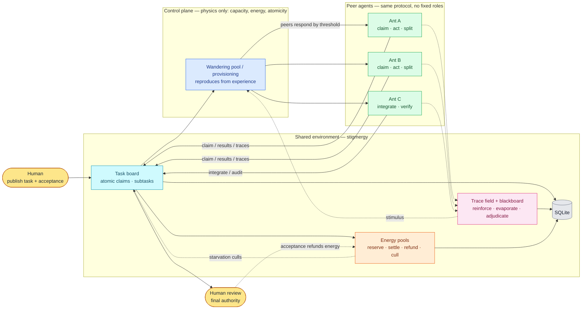

<p align="center">
  
</p>

<h1 align="center">Ant³</h1>

<p align="center"><strong>Swarm intelligence for AI agents, built in Rust.</strong><br>
Small agents. Shared work. Emergent outcomes.</p>

<p align="center">
  <a href="https://github.com/NeoPanic/Ant3/actions/workflows/check.yml"></a>
  <a href="LICENSE"></a>
  
  
  <a href="README.zh-CN.md"></a>
</p>

**Ant³ is a multi-agent platform where peer AI agents self-organize like an ant colony.** Publish a task with acceptance criteria; agents claim work from a shared board, split it, reuse each other's results, and integrate — coordinating through **stigmergy** (a pheromone-style trace field), not a fixed planner. No hardcoded role pipelines: division of labor, recruitment, and collective progress *emerge* from local rules. With self-selection enabled, even task assignment devolves to the individuals — the control plane keeps only physics: capacity, energy, atomicity.

[简体中文](README.zh-CN.md) · [Documentation](docs/README.md) · [Architecture](docs/managed-agents.zh-CN.md) · [Status](docs/status.zh-CN.md) · [Roadmap](docs/roadmap.zh-CN.md) · [Contributing](CONTRIBUTING.md)

## Contents

- [Why Ant³](#why-ant)
- [Swarm mechanisms](#swarm-mechanisms)
- [Quick start](#quick-start)
- [The console: watch a colony, not a dashboard](#the-console)
- [Architecture](#architecture)
- [Use the runtime independently](#use-the-runtime-independently)
- [Status \& boundaries](#status--boundaries)
- [Contribute](#contribute)

## Why Ant³

Most multi-agent frameworks hand you a fixed workflow — a planner, a researcher, a summarizer, wired in a script. That is orchestration, not intelligence.

Ant³ takes the opposite bet, inspired by how ants solve hard problems with no central command:

- **No fixed roles.** Planning and integration are *tasks* any peer can claim, not identities baked into the kernel.
- **Coordination through the environment.** Agents leave durable traces; later agents follow what worked. This is [stigmergy](https://en.wikipedia.org/wiki/Stigmergy), the mechanism behind ant trails.
- **Selection pressure.** Verified success earns energy back; wasteful paths starve and are culled. Budget is an emergence mechanism, not just accounting.
- **Emergence, measured.** A built-in evaluation harness compares one agent against a swarm on the same task and energy budget, so "the swarm is better" is a claim you can test, not assume.

The result is a local-first, single-binary Rust platform you can run, inspect, and extend — with the model/tool loop usable as a standalone crate.

## Swarm mechanisms

| Mechanism | What it does |
| --- | --- |
| **Pheromone trace field** | Results carry a concentration that reinforces on completion, acceptance, and peer reuse, and **evaporates with a 30-minute half-life**. Strong trails attract work; stale ones fade. |
| **Root blackboard + conflict adjudication** | Peers publish findings with CAS revisions and evidence support; conflicting claims are adjudicated by evidence strength, not arrival order. |
| **Response-threshold division of labor** | Each Preset's threshold adapts with experience and energy efficiency. Cheap specialists respond to faint trails; expensive presets need stronger payoff evidence. |
| **Self-selection (optional)** | `ANT3_SELF_SELECT=1`: the central classifier stands down; a wandering pool reproduces from verified experience and idle peers claim work by their own thresholds, racing atomically. |
| **Crowding avoidance \& recruitment** | Stimulus is diluted by workers already on a branch; successful runs amplify the paths they used, recruiting peers. |
| **Local perception** | Agents see their neighborhood and above-threshold trails by default — global order grows from local rules. |
| **Negative feedback \& robustness** | Failure penalizes paths; bounded retries let a fresh peer take over lost work; rework chains cool down and stop at a bound instead of oscillating. |
| **Budget-as-energy** | Dispatch reserves energy; settlement bills real usage; acceptance refunds it. Starved roots stop being offered and their pending work is culled. |
| **Independent verification** | A fresh reviewer instance audits the frozen result against acceptance criteria; passed auto-accepts with reviewer attribution, failed reworks with feedback, unknown falls back to humans. |

> Ant³ implements stigmergy as durable, auditable records with a bounded control plane — not an ant-colony optimization solver. See the [trace field](docs/traces.zh-CN.md), [energy](docs/energy.zh-CN.md), [self-selection](docs/selfselect.zh-CN.md), and [evaluation](docs/evaluation.zh-CN.md) designs.

## Quick start

Requires **Rust 1.99+** (latest stable recommended). Single binary, no external database or Node build.

```sh
git clone https://github.com/NeoPanic/Ant3.git
cd Ant3
cargo run --locked -p ant3-cli -- up
```

Open [localhost:7333](http://127.0.0.1:7333) and sign in with the contents of `.ant3/token`. Then:

1. Configure a model provider and publish a Preset in **Presets**.
2. Publish work + acceptance criteria in **任务板** (Task Board).
3. Watch the colony take it from there; collect results in **成果库** and handle the few things that need you in **需要你处理**.

Ant³ speaks **OpenAI-compatible Chat Completions**, **OpenAI Responses**, and **Anthropic Messages**. Configuration, CLI/API/MCP usage, and local process plugins are in the [getting-started guide](docs/getting-started.zh-CN.md).

## The console

The UI is built for a human watching ants, not an operator reading gauges. You see behavior and outcomes in plain language — who took the work, that a result was referenced four times, that quality check passed, how much budget remains. The colony's coordination chemistry (concentrations, thresholds, ledgers, adjudication rules) stays collapsed in a **researcher view** for when you want to study the emergence itself.

- **Observe** — worksite (animated colony), colony roster + one-sentence swarm narrative + spend/convergence, deliveries.
- **Work** — task board (publish, track, accept), and an inbox aggregating exactly the decisions that need a human.
- **Settings** — Presets, plugins, researcher view (raw runs/events/instances/mechanism parameters).

## Architecture



Solid edges are task flow; dotted edges are stigmergic feedback. The independent Ant owns model/tool execution, policies, session checkpoints, cancellation, and receipts. Checkpoints do not guarantee exactly-once external effects: tools supply their own idempotency or transaction contract. See [runtime contracts](docs/runtime.md) and the [target architecture](docs/managed-agents.zh-CN.md).

## Use the runtime independently

The model/tool loop is a standalone crate, usable without the platform:

```sh
cargo run --locked --example quickstart
```

```toml
[dependencies]
ant3 = { git = "https://github.com/NeoPanic/Ant3.git", branch = "main" }
```

```rust
use ant3::{Ant, Limits, Registry};

let agent = Ant::new(Registry::default(), Limits::default());
```

The [offline example](crates/ant3-core/examples/quickstart.rs) runs a model → tool → model cycle and redelivers the same event to demonstrate session deduplication. Pin a Git revision for reproducible builds. API reference: `cargo doc --locked --workspace --no-deps --open`.

## Status & boundaries

Ant³ is a **pre-1.0 local platform for trusted environments**. Local defaults: 256 instances, 8 execution slots, 64 tasks per board root, which are configured limits, not measured capacity claims. The [swarm conversation](docs/chat.zh-CN.md) streams execution activity and model text; live provider compatibility still needs acceptance testing. Not yet provided: remote MCP plugin loading, distributed scheduling, hosted deployment, strong multi-tenant isolation, cross-root team cost hard caps, and OS-level execution isolation. The single forward-looking list lives in the [roadmap](docs/roadmap.zh-CN.md); precise per-capability boundaries in the [capability index](docs/capabilities.zh-CN.md).

The display name is **Ant³**, the repository is **Ant3**, and technical identifiers use `ant3` (CLI, Cargo packages, protocols, `.ant3/` data directory). **³** expresses the collaboration loop: **claim → contribute → continue**. [Brand assets](docs/brand/README.md).

## Contribute

See [development checks](CONTRIBUTING.md), [security reporting](SECURITY.md), and the [code of conduct](CODE_OF_CONDUCT.md). The [documentation index](docs/README.md) links setup, design, capabilities, and the roadmap.

If Ant³'s take on emergent multi-agent coordination interests you, **star the repo** to follow along — issues and PRs are welcome.

[MIT license](LICENSE).
