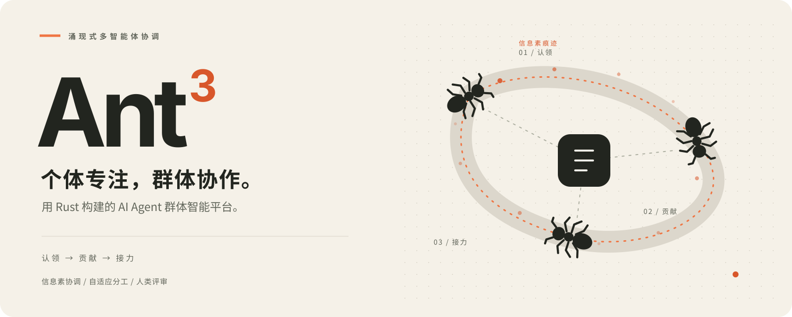
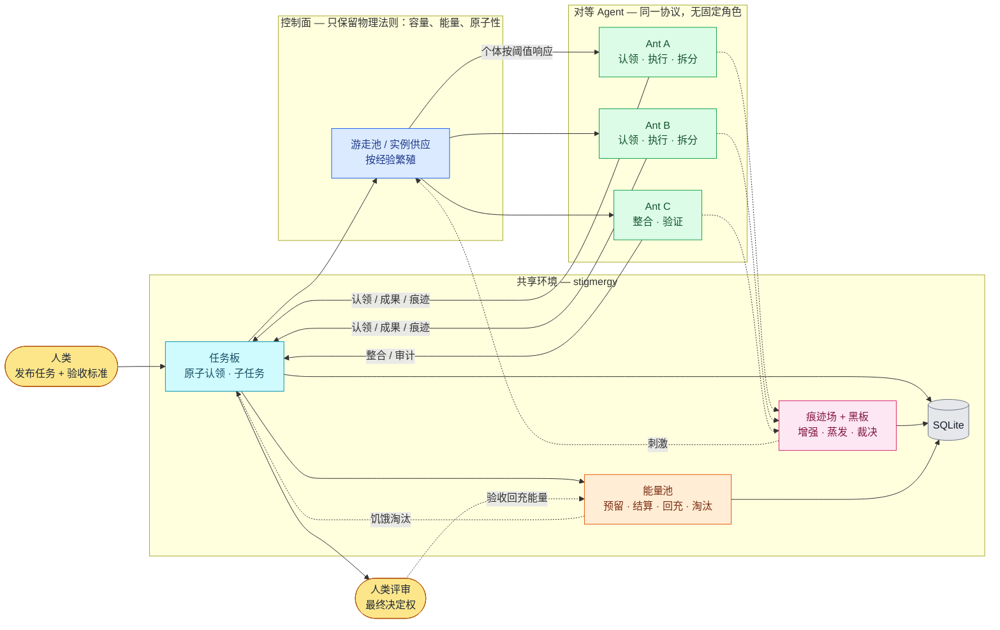

<p align="center">
  
</p>

<h1 align="center">Ant³</h1>

<p align="center"><strong>用 Rust 构建的 AI Agent 群体智能平台。</strong><br>
个体专注，群体协作，涌现成果。</p>

<p align="center">
  <a href="https://github.com/NeoPanic/Ant3/actions/workflows/check.yml"></a>
  <a href="LICENSE"></a>
  
  
  <a href="README.md"></a>
</p>

**Ant³ 是一个让对等 AI Agent 像蚁群一样自组织的多智能体平台。** 发布任务与验收标准后，Agent 从共享任务板认领工作、拆分、复用彼此成果并整合——通过 **stigmergy（信息素痕迹场）** 协调，而非固定规划者。没有硬编码的角色流水线：分工、招募与集体进展从局部规则中**涌现**。开启个体自选后，连任务分配也下沉给个体——控制面只保留物理法则：容量、能量、原子性。

[English](README.md) · [文档导航](docs/README.md) · [架构设计](docs/managed-agents.zh-CN.md) · [当前状态](docs/status.zh-CN.md) · [路线图](docs/roadmap.zh-CN.md) · [参与贡献](CONTRIBUTING.md)

## 目录

- [为什么选 Ant³](#为什么选-ant)
- [群体机制](#群体机制)
- [快速开始](#快速开始)
- [控制台：观察蚁群，而非仪表盘](#控制台)
- [架构](#架构)
- [独立使用运行时](#独立使用运行时)
- [状态与边界](#状态与边界)
- [参与贡献](#参与贡献)

## 为什么选 Ant³

多数多智能体框架给你的是一套固定流程——规划者、研究员、汇总者，用脚本串起来。那是编排，不是智能。

Ant³ 做了相反的押注，灵感来自蚂蚁在没有中央指挥的情况下解决难题的方式：

- **没有固定角色。** 规划和整合是任何对等实例都能认领的*任务*，不是写死在内核里的身份。
- **通过环境协调。** Agent 留下持久痕迹，后来者沿着被验证有效的路径走。这就是 [stigmergy（间接协作）](https://en.wikipedia.org/wiki/Stigmergy)，蚁群路径背后的机制。
- **选择压力。** 验证过的成功赚回能量，浪费的路径饿死淘汰。预算是涌现机制，不只是会计。
- **可度量的涌现。** 内置评估基线在同一任务、同一能量预算下对照单 Agent 与群体，让"群体更优"成为可验证的结论，而非预设。

结果是一个本地优先、单二进制的 Rust 平台，可运行、可审查、可扩展——模型/工具循环还能作为独立 crate 使用。

## 群体机制

以下均已实现，不是路线图承诺：

| 机制 | 作用 |
| --- | --- |
| **信息素痕迹场** | 成果浓度在完成、验收、复用时增强，**30 分钟半衰期蒸发**。强痕迹吸引工作，陈旧痕迹消退。 |
| **板根黑板 + 冲突裁决** | 同伴以 CAS 修订发布发现并引用证据支持；冲突按证据强度裁决，而非先到先得。 |
| **响应阈值分工** | 母体阈值随经验与能量效率自适应。便宜专家响应弱痕迹，昂贵母体需要更强收益证据。 |
| **个体自选（可选）** | `ANT3_SELF_SELECT=1`：中央分类器退位；游走池按验证经验繁殖，待命个体按自己的阈值响应并原子竞争认领。 |
| **拥挤规避与招募** | 刺激被同分支已有工作者稀释；成功 Run 放大其用过的路径，招募同伴。 |
| **局部感知** | Agent 默认只见邻域与超阈值痕迹——全局秩序从局部规则长出。 |
| **负反馈与鲁棒性** | 失败降权路径；有界重试让新个体接手损失的工作；返工链冷却并设上限，抑制振荡。 |
| **预算即能量** | 派发预留能量，结算按真实 usage，验收回充；饥饿根停止供给并淘汰待认领工作。 |
| **独立验证** | 全新验证实例按验收标准审计冻结结果；通过自动归档（验证器署名），退回附意见返工，证据不足交回人类。 |

> Ant³ 以持久、可审计的记录和有界控制面实现 stigmergy，而非蚁群优化求解器。见[痕迹场](docs/traces.zh-CN.md)、[能量](docs/energy.zh-CN.md)、[自选](docs/selfselect.zh-CN.md)与[评估](docs/evaluation.zh-CN.md)设计。

## 快速开始

需要 **Rust 1.99+**（建议最新稳定版）。单二进制，无需外部数据库或 Node 构建。

```sh
git clone https://github.com/NeoPanic/Ant3.git
cd Ant3
cargo run --locked -p ant3-cli -- up
```

打开 [localhost:7333](http://127.0.0.1:7333)，用 `.ant3/token` 的内容登录。然后：

1. 在 **母体 Presets** 配置模型并发布母体。
2. 在 **任务板** 发布工作与验收标准。
3. 看蚁群接手；在 **成果库** 收成果，在 **需要你处理** 处理少数需要你的事。

Ant³ 支持 **OpenAI-compatible Chat Completions**、**OpenAI Responses**、**Anthropic Messages** 三类协议。配置、CLI/API/MCP 用法与本地进程插件见[入门指南](docs/getting-started.zh-CN.md)。

## 控制台

UI 为"看蚂蚁的人"而建，不是给读仪表的运维。你看到的是行为与结果的人话——谁接了活、某份成果被参考了四次、质检通过、预算还剩多少。群体的协调化学（浓度、阈值、账本、裁决规则）默认折叠在**研究者视图**，供你研究涌现本身时展开。

- **观察** — 工作现场（动画蚁群）、蚁群花名册 + 一句话群体动态 + 开销/收敛、成果库。
- **工作** — 任务板（发布/跟踪/验收）、聚合人类决策点的"需要你处理"。
- **设置** — 母体、插件、研究者视图（原始 runs/events/实例/机制参数）。

## 架构



实线为任务流，虚线为 stigmergy 反馈。独立 Ant 拥有模型/工具执行、策略、会话检查点、取消与回执。检查点不保证外部效果恰好一次：工具自行提供幂等或事务契约。见[运行契约](docs/runtime.md)与[目标架构](docs/managed-agents.zh-CN.md)。

## 独立使用运行时

模型/工具循环是独立 crate，可脱离平台使用：

```sh
cargo run --locked --example quickstart
```

```toml
[dependencies]
ant3 = { git = "https://github.com/NeoPanic/Ant3.git", branch = "main" }
```

```rust
use ant3::{Ant, Limits, Registry};

let agent = Ant::new(Registry::default(), Limits::default());
```

[离线示例](examples/quickstart.rs)运行模型 → 工具 → 模型循环，并重投同一事件演示会话去重。固定 Git revision 以获得可复现构建。API 参考：`cargo doc --locked --workspace --no-deps --open`。

## 状态与边界

Ant³ 是**面向可信环境的 pre-1.0 本地平台**。本地默认：256 实例、8 执行槽、每板根 64 任务——配置限制，非实测容量声明。尚未提供：流式模型输出、远程 MCP 插件加载、分布式调度、托管部署、强多租户隔离、跨根团队费用硬上限、OS 级执行隔离。唯一前瞻清单见[路线图](docs/roadmap.zh-CN.md)；逐能力精确边界见[能力索引](docs/capabilities.zh-CN.md)。

显示名为 **Ant³**，仓库为 **Ant3**，技术标识用 `ant3`（CLI、Cargo 包、协议、`.ant3/` 数据目录）。**³** 表达协作闭环：**认领 → 贡献 → 接力**。[品牌资产](docs/brand/README.md)。

## 参与贡献

见[开发检查](CONTRIBUTING.md)、[安全报告](SECURITY.md)与[行为准则](CODE_OF_CONDUCT.md)。[文档导航](docs/README.md)链接启动、设计、能力与路线图。

如果你认同 Ant³ 对涌现式多智能体协调的探索，欢迎 **star 关注**——issue 与 PR 均开放。

[MIT 许可证](LICENSE)。