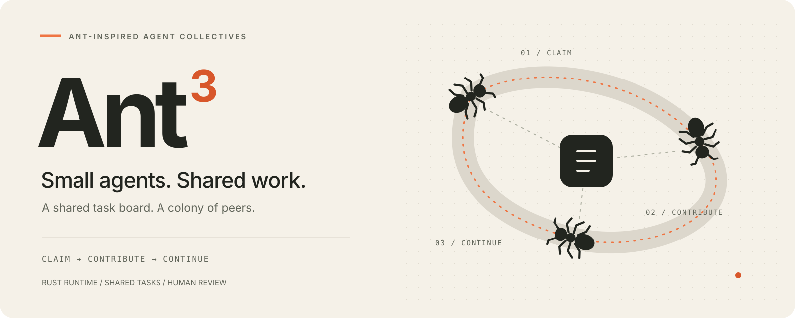
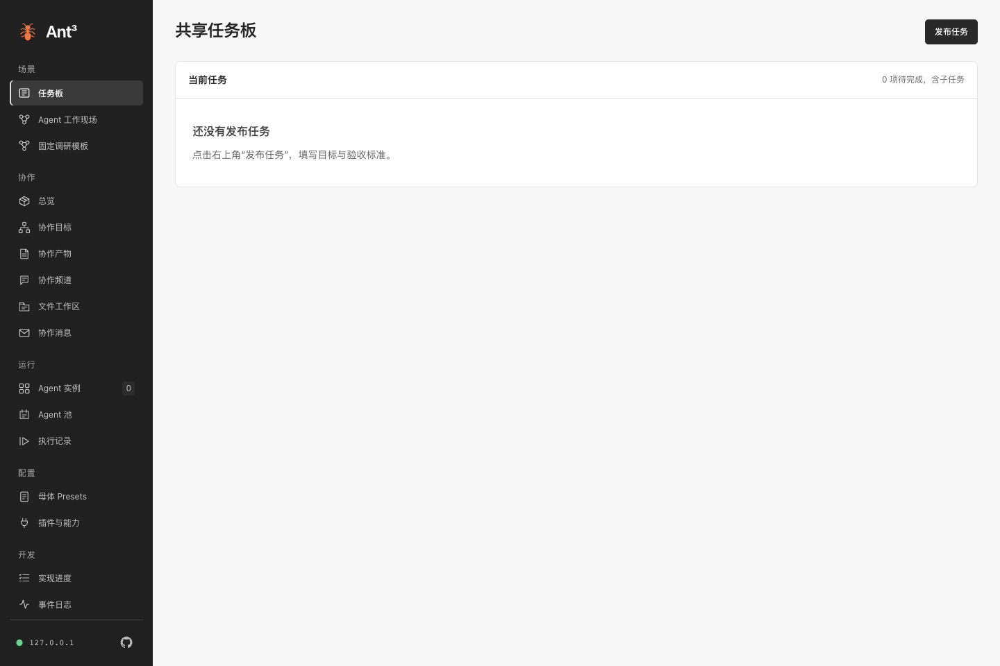
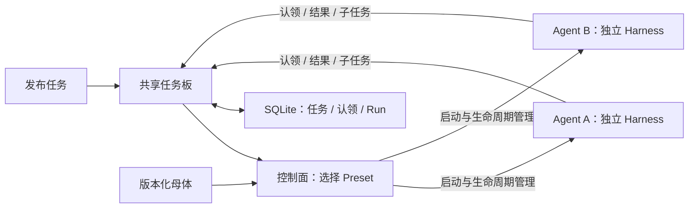

<p align="center">
  
</p>

# Ant³

**个体专注，群体协作。**

Ant³ 是借鉴蚂蚁协作机制、以 Rust 构建的对等 Agent 平台。发布目标和验收标准后，Agent 从共享任务板认领工作、拆分子任务、留下成果，由后续参与者继续推进，最终交给人类评审。

蚂蚁通过改变周围环境传递协作线索；Ant³ 让 Agent 通过持久化的任务、进展和成果接力。控制面负责 Preset 选型、实例启动与容量约束，每个 Agent 使用同一套模型 / 工具循环，并由母体赋予专长。规划和整合同样由普通参与实例承担。

[English](README.md) · [文档导航](docs/README.md) · [架构设计](docs/managed-agents.zh-CN.md) · [当前状态](docs/status.zh-CN.md) · [参与贡献](CONTRIBUTING.md)

## 像蚁群一样协作

| 协作机制 | Ant³ 中的对应 |
| --- | --- |
| 共享痕迹 | 持久任务板保存任务、认领、进展和成果。 |
| 局部行动 | 每个 Agent 认领具体任务，在授权范围内执行。 |
| 分工协作 | 版本化母体提供不同模型、指令和工具。 |
| 成果接力 | 子任务回到任务板，后续参与者整合已完成的贡献。 |
| 反馈闭环 | 人类通过根任务成果，或附意见退回下一轮修改。 |

共享任务板借鉴 **stigmergy（间接协作）**：参与者通过共享环境留下的变化协调行动。当前实现使用明确的任务记录和有界控制面，未实现信息素模拟或蚁群优化算法。

## 本地启动

需要 **Rust 1.99+（建议最新稳定版）**。首次启动为空白工作区；执行任务前需配置模型并发布自己的母体。首次编译由 Cargo 下载依赖。

```sh
git clone https://github.com/NeoPanic/Ant3.git
cd Ant3
cargo run --locked -p harness3-cli -- up
```

打开 [localhost:7333](http://127.0.0.1:7333)，使用 `.harness3/token` 的内容登录。本地状态保存在 `.harness3/`。

1. 配置模型并在 **母体 Presets** 发布母体，再进入 **任务板** 发布工作要求与验收标准。
2. 查看 Preset 选型、实例启动、Agent 认领与执行状态。
3. 在 **Agent 工作现场** 检查回投的子任务、参与实例与结果。

启动不自动创建示例母体、实例或任务。[任务板指南](docs/task-board.zh-CN.md)说明选型、认领、拆分和当前边界。

真实模型支持 **OpenAI-compatible Chat Completions、OpenAI Responses、Anthropic Messages** 三种协议。模型配置、CLI / API / MCP 用法与可信本地进程插件设置见[入门指南](docs/getting-started.zh-CN.md)。

## 本地控制台

首次启动进入空白任务板。配置模型、发布母体后，即可发布第一项任务。



## 当前可以做什么

| 范围 | 可用行为 |
| --- | --- |
| Agent 定义 | 版本化母体、固定版本继承、参数、模型与插件绑定。 |
| 生命周期 | 独立实例；Agent 池统一创建、扩缩容、排空回收与 TTL。 |
| 共享任务板 | 发布未绑定实例的任务；控制面选型、启动，Agent 原子认领并回投子任务。 |
| 显式流程 | 兼容 Goal 依赖图、候选实例领取、有限委派与固定调研模板。 |
| 协作空间 | 点对点消息、目标频道、显式成员、订阅唤醒与共享上下文。 |
| 工作成果 | 私有文件工作区、不可变文本 / 文件 / JSON 快照、跨 Agent 证据交接。 |
| 质量闭环 | 独立验证、证据驱动的局部修复、评审轮次与人工验收。 |
| 能力扩展 | 提示词包、本地进程工具插件、固定版本绑定与健康检查。 |
| 使用入口 | 桌面 Web、HTTP API、CLI、对外 MCP stdio 共用本地持久状态。 |

Agent 池管理同一母体的实例资源；任务板从发布任务开始，按需创建参与实例。根任务执行成功后由人类评审，通过归档或附意见退回修改。Goal 流程的频道、文件产物和独立验证尚未自动接入任务板。

<details>
<summary>展开查看历史界面示例：工作现场、团队协作与文件产物</summary>

以下截图早于 Ant³ 品牌调整，使用历史样例数据。


队员动画对应已记录的执行状态：工作、待命或休息。进入 **Agent 工作现场** 可检查参与实例与任务依赖。

**团队协作。** 团队回收后仍可检查成员、订阅关系和讨论记录。


**工作区证据。** 共享快照保留来源 Agent 与 Run，实例私有文件单独列出。


</details>

当前为面向**可信本地环境的 pre-1.0 平台**。默认上限为 256 个实例、8 个执行槽和每个 Goal 64 项任务；这些是配置限制，不代表实测容量。分布式调度、托管部署、强多租户隔离和远程 MCP 插件加载尚未提供。准确边界见[当前状态](docs/status.zh-CN.md)与[能力及源码索引](docs/capabilities.zh-CN.md)。

## 架构分层



控制面负责容量、Preset 选型与生命周期。Agent 共用认领和拆分协议，规划与整合由普通实例承担；任务父子关系记录依赖和来源，不赋予 Agent 管理同伴的权限。独立 Harness 负责模型 / 工具循环、策略、会话检查点、取消和执行回执。检查点不能独自保证外部副作用恰好执行一次，工具需提供自己的幂等或事务契约。详见[运行契约](docs/runtime.md)与[目标架构](docs/managed-agents.zh-CN.md)。

## 单独使用 Rust 内核

```sh
cargo run --locked --example quickstart
```

[离线示例](examples/quickstart.rs)演示模型 → 工具 → 模型循环，再重复投递同一事件，验证会话去重。

```toml
[dependencies]
harness3 = { git = "https://github.com/NeoPanic/Ant3.git", branch = "main" }
```

```rust
use harness3::{Harness, Limits, Registry};

let harness = Harness::new(Registry::default(), Limits::default());
```

完整能力注册参照示例。下游项目应固定 Git revision，保证构建可复现。API 文档：`cargo doc --locked --workspace --no-deps --open`。

## 为什么叫 Ant³？

单只蚂蚁承担局部工作，蚁群将许多个体行动组合成共同成果。**³** 表达三个相连的协作环节：**认领 → 贡献 → 接力**，也表达个体能力通过协作组合的含义；执行规模和权限仍由平台明确约束。

正文品牌为 **Ant³**，仓库名为 **Ant3**。现有 Cargo 包、CLI 命令、API 标识及 `.harness3/` 数据目录继续使用 `harness3`，保证现有集成可用。[品牌素材与使用规范](docs/brand/README.md)。

## 参与项目

参阅[开发与检查流程](CONTRIBUTING.md)、[安全报告](SECURITY.md)和[行为准则](CODE_OF_CONDUCT.md)。[文档导航](docs/README.md)按入门、当前能力、设计目标和专题契约组织资料。

[MIT 许可证](LICENSE)。
