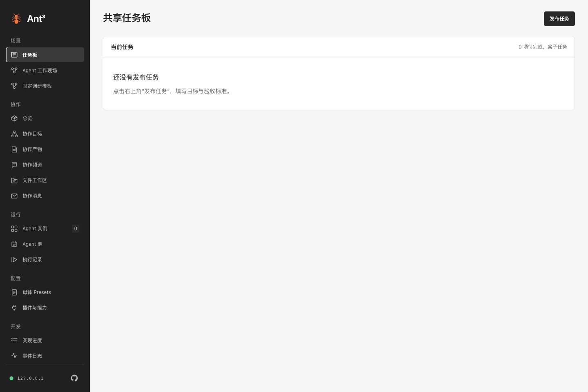
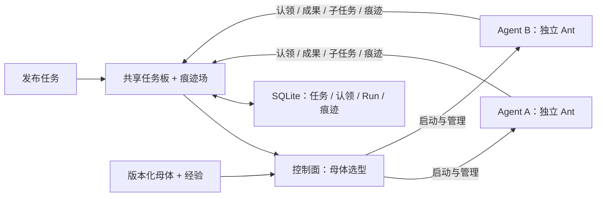

<p align="center">
  
</p>

<h1 align="center">Ant³</h1>

<p align="center"><strong>用 Rust 构建的 AI Agent 群体智能平台。</strong><br>
个体专注，群体协作，涌现成果。</p>

<p align="center">
  <a href="https://github.com/NeoPanic/Ant3/actions/workflows/check.yml"></a>
  <a href="LICENSE"></a>
  
  
  <a href="README.md"></a>
</p>

**Ant³ 是一个让对等 AI Agent 像蚁群一样自组织的多智能体平台。** 发布任务与验收标准后，Agent 从共享任务板认领工作、拆分、复用彼此成果并整合——通过 **stigmergy（信息素痕迹场）** 协调，而非固定规划者。没有硬编码的角色流水线：分工与集体进展从局部规则中**涌现**。

[English](README.md) · [文档导航](docs/README.md) · [架构设计](docs/managed-agents.zh-CN.md) · [当前状态](docs/status.zh-CN.md) · [参与贡献](CONTRIBUTING.md)

## 目录

- [为什么选 Ant³](#为什么选-ant)
- [群体机制](#群体机制)
- [快速开始](#快速开始)
- [蚁群如何协作](#蚁群如何协作)
- [可用能力](#可用能力)
- [架构](#架构)
- [独立使用运行时](#独立使用运行时)
- [状态与边界](#状态与边界)
- [参与贡献](#参与贡献)

## 为什么选 Ant³

多数多智能体框架给你的是一套固定流程——规划者、研究员、汇总者，用脚本串起来。那是编排，不是智能。

Ant³ 做了相反的押注，灵感来自蚂蚁在没有中央指挥的情况下解决难题的方式：

- **没有固定角色。** 规划和整合是任何对等实例都能认领的*任务*，不是写死在内核里的身份。
- **通过环境协调。** Agent 留下持久痕迹，后来者沿着被验证有效的路径走。这就是 [stigmergy（间接协作）](https://en.wikipedia.org/wiki/Stigmergy)，蚁群路径背后的机制。
- **可度量的涌现。** 内置评估基线在同一任务、同一预算下对照单 Agent 与群体，让"群体更优"成为可验证的结论，而非预设。

结果是一个本地优先、单二进制的 Rust 平台，可运行、可审查、可扩展——模型/工具循环还能作为独立 crate 使用。

## 群体机制

以下均已实现，不是路线图承诺：

| 机制 | 作用 |
| --- | --- |
| **信息素痕迹场** | 任务与成果带有浓度，在完成、人类验收、同级复用时增强，并**以 30 分钟半衰期蒸发**。强痕迹吸引工作，陈旧痕迹消退。 |
| **响应阈值分工** | 每个母体的阈值随经验自适应（成功降低、失败升高）。专家响应弱痕迹，新手追逐强痕迹。 |
| **拥挤规避** | 任务刺激被同分支已有工作者数量稀释，群体跨分支分散而非扎堆。 |
| **招募与负反馈** | 成功 Run 放大其用过的路径；确定失败惩罚路径。死路失去吸引力。 |
| **局部感知** | Agent 默认只见邻域而非整板——全局秩序从局部规则长出。 |
| **个体损失鲁棒性** | 损失一个工作者，其任务在有界重试预算内重排队，新个体接手，群体仍收敛。 |
| **原子认领与拆分** | 每任务单一有效执行者；子任务回板触发新一轮选型。无对等实例互相控制。 |

> Ant³ 以持久、可审计的记录和有界控制面实现 stigmergy，而非字面意义的蚁群优化求解器。见[痕迹场设计](docs/traces.zh-CN.md)与[评估基线](docs/evaluation.zh-CN.md)。

## 快速开始

需要 **Rust 1.99+**（建议最新稳定版）。单二进制，无需外部数据库或 Node 构建。

```sh
git clone https://github.com/NeoPanic/Ant3.git
cd Ant3
cargo run --locked -p ant3-cli -- up
```

打开 [localhost:7333](http://127.0.0.1:7333)，用 `.ant3/token` 的内容登录。然后：

1. 在 **母体 Presets** 配置模型并发布母体。
2. 在 **任务板** 发布工作与验收标准。
3. 在 **Agent 工作现场** 观察选型、认领、拆分与整合；查看每个任务的痕迹浓度。

Ant³ 支持 **OpenAI-compatible Chat Completions**、**OpenAI Responses**、**Anthropic Messages** 三类协议。配置、CLI/API/MCP 用法与本地进程插件见[入门指南](docs/getting-started.zh-CN.md)。



## 蚁群如何协作

| 协作机制 | Ant³ 中的对应 |
| --- | --- |
| 共享痕迹 | 持久任务板保存任务、认领、进展、成果与信息素浓度。 |
| 局部行动 | 每个 Agent 认领任务，在授权范围与邻域内执行。 |
| 分工协作 | 版本化母体提供模型/指令/工具；自适应阈值使其专业化。 |
| 成果接力 | 子任务回到任务板，后续参与者整合已完成的贡献。 |
| 反馈闭环 | 人类通过根任务成果或附意见退回；成功/失败重塑痕迹。 |

控制面负责母体选型、实例启动与容量、权限、预算约束，但**不是永久 leader**。每个 Agent 使用同一套模型/工具循环，由母体赋予专长。

## 可用能力

| 领域 | 已提供行为 |
| --- | --- |
| Agent 定义 | 版本化母体、固定继承、参数、模型与插件绑定。 |
| 生命周期 | 独立实例；Agent 池供应、扩缩容、退休与 TTL。 |
| 共享任务板 | 发布无绑定任务；选型、启动实例、原子认领、拆分、失败重排队。 |
| 群体协调 | 信息素痕迹、响应阈值分工、拥挤规避、招募、局部感知。 |
| 显式脚手架 | Goal 依赖图、候选池认领、有界动态委派（用户/Agent 主动发起，非固定流水线）。 |
| 协作 | 点对点消息、Goal 频道、订阅、共享版本化上下文。 |
| 交付物 | 私有工作区、不可变文本/文件/JSON 快照、同级证据交接。 |
| 评审 | 独立验证、证据关联返工、评审轮次、人类验收。 |
| 扩展 | 提示词包与本地进程工具插件，固定版本与健康检查。 |
| 入口 | 桌面 Web、HTTP API、CLI、对外 MCP stdio 共享持久本地状态。 |

根任务完成后等待人类评审：通过归档，或附意见退回继续。自动独立验证尚未接入任务板本身。

<details>
<summary>更多控制台视图：工作现场、协作与产物</summary>


队员动画反映记录的执行状态：工作、等待或休眠。


</details>

## 架构



独立 Ant 拥有模型/工具执行、策略、会话检查点、取消与回执。检查点不保证外部效果恰好一次：工具自行提供幂等或事务契约。见[运行契约](docs/runtime.md)与[目标架构](docs/managed-agents.zh-CN.md)。

## 独立使用运行时

模型/工具循环是独立 crate，可脱离平台使用：

```sh
cargo run --locked --example quickstart
```

```toml
[dependencies]
ant3 = { git = "https://github.com/NeoPanic/Ant3.git", branch = "main" }
```

```rust
use ant3::{Ant, Limits, Registry};

let agent = Ant::new(Registry::default(), Limits::default());
```

[离线示例](examples/quickstart.rs)运行模型 → 工具 → 模型循环，并重投同一事件演示会话去重。固定 Git _revision 以获得可复现构建。API 参考：`cargo doc --locked --workspace --no-deps --open`。

## 状态与边界

Ant³ 是**面向可信环境的 pre-1.0 本地平台**。本地默认：256 实例、8 执行槽、每 Goal 64 任务——这是配置限制，非实测容量声明。尚未提供：分布式调度、托管部署、强多租户隔离、费用硬预算、远程 MCP 插件加载。精确边界见[当前状态](docs/status.zh-CN.md)与[能力/源码索引](docs/capabilities.zh-CN.md)。

显示名为 **Ant³**，仓库为 **Ant3**，技术标识用 `ant3`（CLI、Cargo 包、协议、`.ant3/` 数据目录）。**³** 表达协作闭环：**认领 → 贡献 → 接力**。[品牌资产](docs/brand/README.md) · [升级指南](docs/upgrade-ant3.zh-CN.md)。

## 参与贡献

见[开发检查](CONTRIBUTING.md)、[安全报告](SECURITY.md)与[行为准则](CODE_OF_CONDUCT.md)。[文档导航](docs/README.md)链接启动、设计目标、能力与工作流契约。

如果你认同 Ant³ 对涌现式多智能体协调的探索，欢迎 **star 关注**——issue 与 PR 均开放。

[MIT 许可证](LICENSE)。