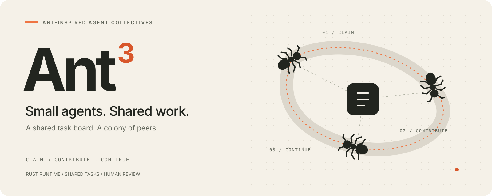

# Ant³ brand

**Small agents. Shared work.** / **个体专注，群体协作。**

Ant³ is an ant-inspired platform for peer AI agents, built on a composable Rust runtime. Agents coordinate through a shared task board, contribute focused work, and leave results for the next participant. Humans review completed root results and can request another round.

## Meaning

The ant expresses local action and division of labor. The superscript **³** connects three steps: **claim → contribute → continue**. The three body segments give the mark a visual echo of that loop. The name describes composition; configured capacity, scope, and permissions still bound execution.

The shared board draws on **stigmergy**, coordination through changes to a shared environment. Tasks, claims, progress, and results act as explicit coordination traces. Presets provide specialization; the control plane selects Presets and manages instances. This analogy describes the design inspiration. Pheromone simulation and ant-colony optimization are outside the current implementation.

## Names and compatibility

| Context | Name |
| --- | --- |
| Display name, including navigation | **Ant³** |
| ASCII brand / GitHub repository | `Ant3` |
| English tagline | Small agents. Shared work. |
| Chinese tagline | 个体专注，群体协作。 |
| English description | An ant-inspired Rust platform for peer AI agents to claim tasks, share results, and build together. |
| Chinese description | 借鉴蚂蚁协作机制的 Rust Agent 平台，通过共享任务板认领工作、分工与成果接力。 |
| Canonical URL | https://github.com/NeoPanic/Ant3 |
| Cargo package / Rust import / CLI | `harness3` |
| Rust execution type | `Harness` |
| Default data directory / environment prefix | `.harness3/` / `HARNESS3_` |
| Plugin and MCP protocol identifiers | Existing `harness3` identifiers |

Use **³** (U+00B3) in display text; use `Ant3` where ASCII is required. Existing package, protocol, command, and storage identifiers are retained so users can open their workspaces and run existing integrations. Repository links use the current `Ant3` URL. This branding change does not rename published packages.

## Assets

| Asset | Intended use |
| --- | --- |
| [banner.svg](banner.svg) | README hero; wordmark, tagline, three ants, and shared-task paths. |
| [mark.svg](mark.svg) | Warm orange ant for dark navigation and the favicon. |
| [mark-mono.svg](mark-mono.svg) | Ink ant for light backgrounds and single-color use. |
| [social-preview.png](social-preview.png) | 1280 × 640 social sharing image; upload in GitHub repository settings. |

The ant has three body segments, six legs, and two bent antennae. The banner connects three peers through a shared task node. Dotted paths suggest coordination through shared traces. All SVGs are static, self-contained, and include accessible titles and descriptions; the marks contain geometry only. The banner uses system fonts.

## Palette and placement

| Role | Color |
| --- | --- |
| Paper background | `#F5F1E8` |
| Ink / monochrome mark | `#22251F` |
| Ant / trail accent | `#EF7543` |
| Accent text on paper | `#D8572B` |
| Secondary text | `#62665B` |
| Dividers / trail bed | `#D9D4C8` |

Keep at least one sixth of the mark's width as clear space. Use the mark at 24 px or larger; use the full banner at 720 px or larger. Keep its aspect ratio. Use the ink mark on light backgrounds and the orange mark on dark backgrounds. Provide the display name in adjacent text or alt text. Operational console content keeps its neutral palette; orange identifies the brand without replacing semantic status colors.

Product screenshots must show the current interface. Historical screenshots remain labeled as historical examples and do not substitute for the current task-board screenshot. The first workspace is empty; brand visuals do not imply preloaded agents or tasks.

## License and attribution

Brand assets are provided under the repository's [MIT license](../../LICENSE). Preserve applicable notices when redistributing them. Descriptive references are welcome; derivatives, integrations, and forks must not imply an official Ant³ release or maintainer endorsement.

The original `Radar contributors` copyright notice in LICENSE remains to preserve upstream attribution.
